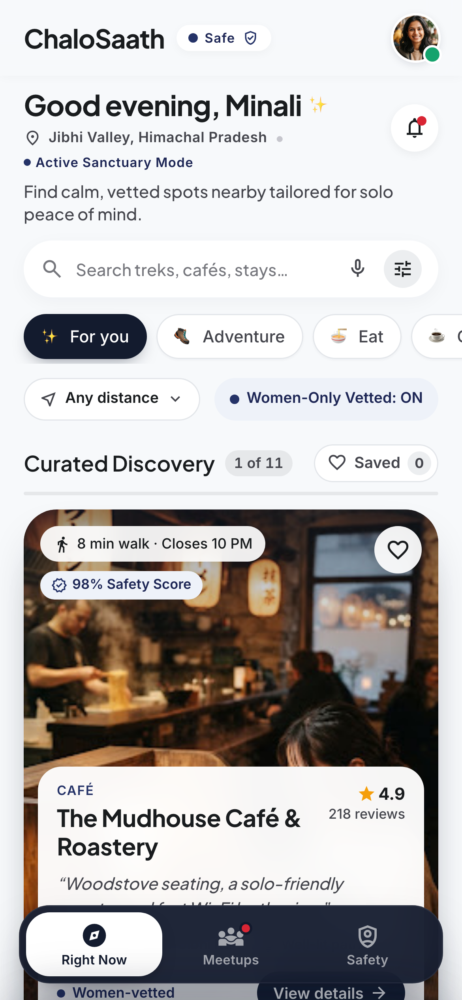
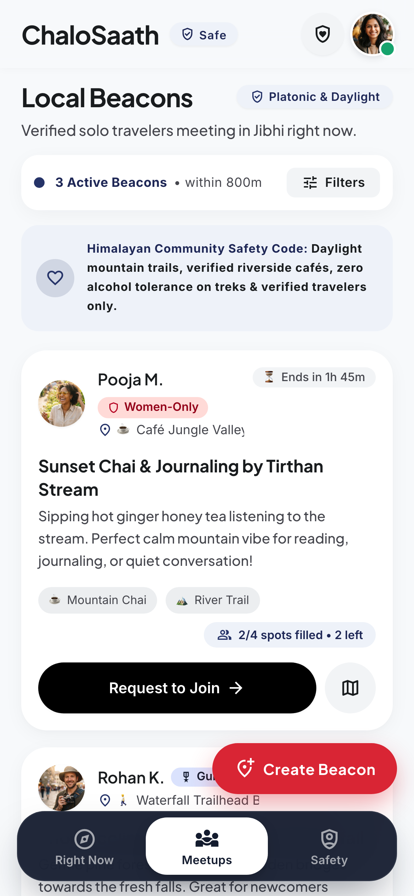
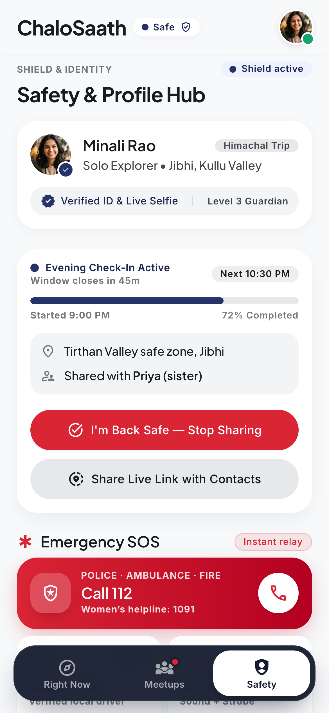

# ChaloSaath

**A safety-first companion app for solo travellers, wherever they are.**

ChaloSaath ("let's go together") helps people travelling alone find places worth going to right now, meet other verified travellers nearby, and stay safe while they do it. Everything adapts to where the traveller is right now. In the demo, that's Jibhi in Himachal Pradesh.

**Live app:** https://chalosaath-4797.web.app

Built at the [**Build with AI Bootcamp**](https://promptwars.in/bootcamp.html) by Hack2skill and Google for Developers in Gurugram (13 November 2026), under the guidance of **Brahmjit Singh**.

<p align="center">
  &nbsp;
  &nbsp;
  
</p>

---

## What it does

### Right Now: find a place
- Swipe through spots near you: right to save, left to pass. Tapping a card opens its details.
- Filter by mood (calm, adventure, social, creative, focus and more), walking distance, and how safe a spot is rated.
- Each spot shows a safety meter, why it's recommended, and real photos.
- Open your saved places at any time, or start a beacon from a spot.

### Meetups: find people
- Browse "beacons": small, short-lived meetups posted by travellers nearby, each marked with the host's verification.
- Ask to join. Once the host accepts, you can message them, and you can leave whenever you like.
- Post your own beacon. It expires on its own.
- Filter by host type, activity, time, and spots left. Women-only mode is included.
- See the meetup spot on a map with walking directions. Read the community safety code, or report a concern.

### Safety: stay safe
- Check in with "I'm back safe" to let your emergency contact know.
- Share your live location link, sound a loud alarm, or call emergency numbers.
- Book a verified cab back to where you're staying.
- Control what you share with privacy toggles.
- Edit your profile and emergency contact. Your changes show up across the app.

Everything you do (saves, joins, chats, check-ins, settings) is stored on your device, so it's still there after a reload.

> **Prototype note:** Host approvals, chat replies, cab bookings and safety reports are simulated on the device. Connecting them to real people and services would need a backend.

---

## How it was made

Made end to end with Google's AI tools:

| Stage | Tools |
|---|---|
| **Think** | Gemini and Stitch: shaping the idea, the product spec and the screen designs |
| **Build** | Google AI Studio and Antigravity: turning the designs into a working app |
| **Publish** | Google Cloud: hosted on Firebase Hosting |

## Built with

- **HTML, Tailwind CSS and vanilla JavaScript.** No framework.
- **Tailwind compiled at build time**, so pages load fully styled with no flash.
- **View Transitions API** for native-feeling page switches and the animated tab bar.
- **Pointer events** for the swipe deck (direction lock and fling speed), plus trackpad swiping.
- **localStorage** to keep app state on the device.
- **Firebase Hosting** on Google Cloud (free Spark plan).

## Project structure

```
index.html        Right Now (swipe deck, filters, saved places)
meetups.html      Meetups (beacons, join flow, chat, map)
safety.html       Safety (check-in, alarm, cab, privacy)
phone.html        Shows the app inside a phone frame on desktop
rightnow.js/.css  Swipe deck, spot data, venue sheet
mobile.js         App shell: tab bar, transitions, toasts, meetups and safety flows
flows.js          Notifications, edit profile, safety guide, map, check-in, cab
app.css           Compiled stylesheet (generated by build/build.py)
build/            Build script, Tailwind config, shell styles
img/              Spot photos (see credits below)
```

## Run it locally

Serve the folder with any static server:

```bash
python3 -m http.server 8080
```

Then open http://localhost:8080.

## Build and deploy

The build needs Node.js (for Tailwind) and Python 3:

```bash
python3 build/build.py
```

To deploy to Firebase Hosting, which runs the build and then deploys:

```bash
./deploy.sh
```

## Acknowledgements

- **Hack2skill** and **Google for Developers** for the Build with AI Bootcamp.
- **Brahmjit Singh** for mentorship and guidance throughout the project.

### Photo credits

All photos come from Wikimedia Commons under the [CC BY-SA 4.0](https://creativecommons.org/licenses/by-sa/4.0/) licence:

| Photo | Author | Source |
|---|---|---|
| Jibhi Waterfall | Rohan Pinto | [Wikimedia Commons](https://commons.wikimedia.org/wiki/File:Jibhi_Waterfall,_Jibhi,_Himachal_Pradesh.jpg) |
| Serolsar Lake, Jalori Pass | Skp098 | [Wikimedia Commons](https://commons.wikimedia.org/wiki/File:Serolsar_Lake,_Jalori_Pass.jpg) |
| Tirthan River | Debashritaiitmandi | [Wikimedia Commons](https://commons.wikimedia.org/wiki/File:Tirthan_River_Tirthan_Valley_DSC00968.jpg) |
| Raghupur Fort | Gannu03 | [Wikimedia Commons](https://commons.wikimedia.org/wiki/File:Raghupur_Fort_in_Himachal_Pradesh_01.jpg) |
| Bahu village, Banjar | Rajani Gairshail | [Wikimedia Commons](https://commons.wikimedia.org/wiki/File:Bahu_village,_Banjar,_Himachal_Pradesh.jpg) |
